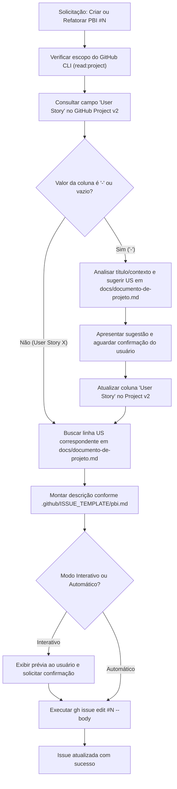

# Gestão e Sincronização de PBIs (`pbi-manager`)

Esta skill define e executa o fluxo automatizado para **criação, refatoração e sincronização de PBIs (Product Backlog Items)** do projeto **MVP Menina Mulher**.

Ela integra as **Issues do GitHub**, o **GitHub Project v2** (Kanban/Tabela) e a especificação canônica do produto em [`docs/documento-de-projeto.md`](file:///c:/Users/20242ewbj0112/Estudos/Projetos/MVP-MeninaMulher/docs/documento-de-projeto.md), garantindo que todo PBI tenha:
1. Uma **História de Usuário** clara e alinhada ao projeto.
2. Vínculos explícitos com os **Requisitos Funcionais (`RF`)** e **Não Funcionais (`RNF`)**.
3. **Critérios de Aceitação** objetivos e testáveis.
4. Rastreabilidade com o **GitHub Project** e com o **Épico pai**.

---

## 1. Quando Ativar esta Skill

Ative e utilize as instruções desta skill sempre que:
* O usuário solicitar a criação de um novo PBI (ex: *"crie o PBI para o carrinho de compras"*).
* O usuário solicitar refatorar, preencher ou atualizar a descrição de um PBI existente (ex: *"refatore o PBI #20"*, *"atualize a descrição da issue #22 com a User Story"*).
* O usuário invocar `/pbi-manager`.
* Houver necessidade de auditar ou sincronizar os campos de User Story do GitHub Project com o repositório.

---

## 2. Fluxo Operacional Passo a Passo



---

## 3. Passo 1: Consulta da Coluna "User Story" no GitHub Project

Para ler o campo personalizado `"User Story"` de uma issue no GitHub Project v2:

### 3.1 Consulta via GitHub CLI (GraphQL)
Execute uma query GraphQL para obter os campos do item no projeto:

```powershell
$issueNumber = <NUMERO_DA_ISSUE>
$query = @"
query {
  repository(owner: "Caioxlw", name: "MVP-MeninaMulher") {
    issue(number: $issueNumber) {
      id
      title
      body
      parent {
        number
        title
      }
      projectItems(first: 5) {
        nodes {
          id
          project {
            id
            title
          }
          fieldValues(first: 20) {
            nodes {
              ... on ProjectV2ItemFieldSingleSelectValue {
                name
                field {
                  ... on ProjectV2SingleSelectField {
                    name
                  }
                }
              }
              ... on ProjectV2ItemFieldTextValue {
                text
                field {
                  ... on ProjectV2Field {
                    name
                  }
                }
              }
            }
          }
        }
      }
    }
  }
}
"@

$queryJson = @{ query = $query } | ConvertTo-Json -Compress
$queryJson | gh api graphql --input -
```

### 3.2 Tratamento de Falha de Escopo (`read:project`)
Se o comando retornar `INSUFFICIENT_SCOPES` para `projectsV2`:
1. Alerte imediatamente o usuário de que a leitura de colunas do GitHub Projects requer o escopo `project`.
2. Oriente a execução de:
   ```powershell
   gh auth refresh -s project
   ```
3. Alternativamente, solicite ao usuário no chat: *"Qual é a User Story (ex: US01, US02) desta issue?"* caso ele prefira não reautenticar o CLI no momento.

---

## 4. Passo 2: Tratamento da Exceção (`"-"` ou Não Preenchido)

Se o valor do campo `"User Story"` for `"-"`, `null` ou não estiver atribuído no Project:

1. **Leitura da base de especificação**:
   - Abra e leia a Seção 3 (*Requisitos Funcionais*) e a Seção 5 (*User Stories*) de [`docs/documento-de-projeto.md`](file:///c:/Users/20242ewbj0112/Estudos/Projetos/MVP-MeninaMulher/docs/documento-de-projeto.md).
2. **Inferência contextual**:
   - Analise o título da issue e suas palavras-chave (ex: `Catálogo`, `Carrinho`, `WhatsApp`, `Estoque`, `Painel`, `Pedidos`, `Autenticação`).
   - Identifique a User Story (`US01` a `US12`) mais aderente ao objetivo da issue.
3. **Aprovação do usuário**:
   - Exiba a sugestão no chat:
     > *"Identifiquei que o campo 'User Story' no projeto está marcado como `-`. Com base no escopo `[Título da Issue]`, a história mais aderente é **USXX: [Texto da US]**. Deseja utilizá-la?"*
4. **Atualização do GitHub Project**:
   - Após a confirmação, atualize o campo `"User Story"` no Project v2 através da mutation `updateProjectV2ItemFieldValue` para manter a integridade dos dados na visão de tabela/Kanban.

---

## 5. Passo 3: Mapeamento em `docs/documento-de-projeto.md`

Ao identificar o valor da coluna (ex: `"User Story 1"`, `"User Story 12"` ou `"US05"`):

1. **Localize a linha na tabela da Seção 5 (`User Stories`)**:
   - `User Story 1` $\rightarrow$ `US01`
   - `User Story 2` $\rightarrow$ `US02`
   - ...
   - `User Story 12` $\rightarrow$ `US12`

2. **Extraia os dados**:
   - **História de Usuário**: extraia o texto exato (*"Como [persona], quero [ação], para [benefício]"*).
   - **Requisitos Funcionais (`RF`)**: extraia a lista de requisitos associados da coluna *Requisitos* (ex: `RF02, RF04`).

3. **Complemente com Requisitos Não Funcionais (`RNF`)**:
   - Consulte a Seção 3.2 de [`docs/documento-de-projeto.md`](file:///c:/Users/20242ewbj0112/Estudos/Projetos/MVP-MeninaMulher/docs/documento-de-projeto.md) e inclua os RNFs pertinentes ao escopo:
     - `RNF01` (Mobile-first a partir de 360 px) para telas de cliente ou painel responsivo.
     - `RNF02` (Carregamento em até 3s em 4G) para vitrine/catálogo.
     - `RNF03` (Enviar pedido ao WhatsApp em até 2 toques) para carrinho e fechamento.
     - `RNF04` (Painel simples: cadastrar em até 3 min / confirmar em até 2 cliques) para telas administrativas.
     - `RNF05` (Segurança, hash e JWT) para endpoints e rotas protegidas da empresária.
     - `RNF07` (Acessibilidade WCAG, contraste e áreas de toque de no mínimo 44 px).
     - `RNF09` (Integridade de estoque sem permitir saldo negativo) para baixa automática e concorrência.

---

## 6. Passo 4: Estruturação Padronizada da Descrição do PBI

Toda descrição de PBI **DEVE** seguir a estrutura estabelecida em [`.github/ISSUE_TEMPLATE/pbi.md`](file:///c:/Users/20242ewbj0112/Estudos/Projetos/MVP-MeninaMulher/.github/ISSUE_TEMPLATE/pbi.md) e nas issues canônicas do projeto (como a Issue `#98`):

```markdown
## 👤 História de Usuário
**Como** <cliente / empresária da loja Menina Mulher>,
**quero** <ação específica e clara descrita na US>,
**para** <benefício ou valor de negócio pretendido>.

## 📌 Contexto e Regras de Negócio
- **Requisitos Funcionais relacionados:** `RF__` (<descrição curta do RF>), `RF__` (<descrição curta do RF>)
- **Requisitos Não Funcionais relacionados:** `RNF__` (<especificação do critério não funcional>)
- **Histórias de Usuário habilitadas:** `US__` (<texto resumido da User Story>)
- **Escopo deste PBI:** <detalhamento objetivo do que está dentro do escopo: front-end, back-end, telas ou regras>
- **Épico:** `#<N>` (<Título do Épico pai>).
- **Dependências:** `#<N>` (<issues ou PBIs predecessores, se houver>).

## ✅ Critérios de Aceitação
- [ ] <Critério 1 objetivo e testável>
- [ ] <Critério 2 objetivo e testável>
- [ ] <Critério 3 objetivo e testável>

## 🔗 Tasks Técnicas (Opcional)
- [ ] #
```

---

## 7. Passo 5: Aplicação da Descrição (Modos de Execução)

### Modo Interativo (Padrão)
1. Gere a descrição completa formatada em Markdown.
2. Apresente a prévia detalhada no chat para o desenvolvedor.
3. Solicite a confirmação explícita:
   > *"Deseja que eu aplique esta descrição no PBI #<N> no GitHub via `gh issue edit`?"*
4. Somente após a confirmação do desenvolvedor, execute a atualização.

### Modo Automático / Direto
Caso o usuário tenha solicitado explicitamente ação direta (ex: *"atualize diretamente o PBI #20 sem confirmação"* ou *"aplique imediatamente"*):
1. Monte o corpo do Markdown.
2. Execute diretamente a atualização via GitHub CLI:

```powershell
$body = @"
<CONTEUDO_DO_MARKDOWN>
"@

$body | gh issue edit <NUMERO_DA_ISSUE> --body-file -
```

3. Exiba uma mensagem de sucesso confirmando a atualização e linkando para a issue no GitHub.
