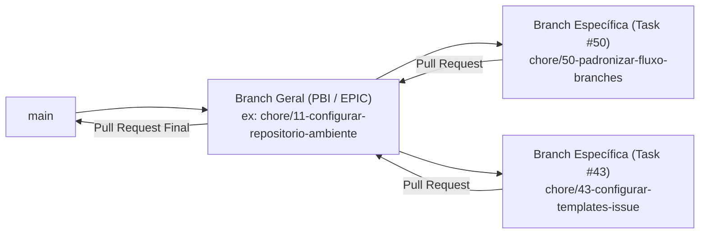

# Guia de Contribuição e Fluxo de Branches 🤝

Este documento descreve o padrão oficial de nomenclatura de branches, commits e o fluxo de trabalho no Git do projeto **MVP Menina Mulher**, além de explicar como utilizar a **Skill automatizada (`git-branch`)** no Antigravity.

---

## 🌿 1. Padrão de Nomenclatura de Branches

Todas as branches do repositório (exceto `main`) devem seguir o formato:

```text
<tipo>/<numero-da-issue>-<slug-kebab-case>
```

### Prefixos Permitidos (`<tipo>`)

Utilizamos os prefixos baseados no **Conventional Commits**:

| Prefixo    | Quando utilizar                                                      | Exemplo                                    |
| ---------- | -------------------------------------------------------------------- | ------------------------------------------ |
| `feat`     | Nova funcionalidade de produto (catálogo, carrinho, painel, estoque) | `feat/20-listar-catalogo-produtos`         |
| `fix`      | Correção de bug identificado durante o desenvolvimento               | `fix/33-corrigir-baixa-estoque-simultanea` |
| `hotfix`   | Correção urgente aplicada diretamente a partir da `main`             | `hotfix/55-corrigir-link-whatsapp`         |
| `docs`     | Criação ou atualização exclusiva de documentação                     | `docs/1-contexto-projeto-readme`           |
| `refactor` | Melhoria interna de código sem alterar comportamento externo         | `refactor/12-ajustar-relacoes-prisma`      |
| `chore`    | Configurações de projeto, pacotes, templates e tooling               | `chore/50-padronizar-fluxo-branches`       |
| `ci`       | Configuração de pipelines e GitHub Actions (`.github/workflows/`)    | `ci/47-configurar-workflow-build`          |
| `test`     | Adição ou ajuste de testes automatizados                             | `test/34-testes-fluxo-completo`            |

### Regras de Validação

- **Expressão Regular (Regex)**:
  ```regex
  ^(feat|fix|hotfix|docs|refactor|chore|ci|test)\/[0-9]+-[a-z0-9]+(-[a-z0-9]+)*$
  ```
- O `<numero-da-issue>` deve ser apenas o número (ex: `50`), **sem** o prefixo `issue-`.
- O `<slug-kebab-case>` deve conter apenas letras minúsculas sem acento, números e hifens.

---

## 🌳 2. Fluxo Hierárquico de Branches (Branch Geral $\rightarrow$ Branch Específica)

No GitHub, o backlog do projeto é estruturado em três níveis: **EPIC $\rightarrow$ PBI $\rightarrow$ TASK**.
Para manter as entregas organizadas por funcionalidade:

1. **Branch Geral da Funcionalidade (Base)**:
   - Quando você vai resolver uma **TASK** (ex: `#50`), a branch geral representa o **PBI pai** ao qual ela pertence (ex: `#11` $\rightarrow$ `chore/11-configurar-repositorio-ambiente`).
   - Quando você vai resolver um **PBI** que não possui sub-tasks, a branch geral representa o **EPIC pai** (ex: `#4` $\rightarrow$ `feat/4-fundacao-e-design`).
   - A **Branch Geral** sempre nasce a partir da `main` atualizada e é publicada imediatamente no GitHub (`git push -u origin <branch-geral>`).
2. **Branch Específica (Objetivo Específico)**:
   - Nasce a partir da **Branch Geral** (`git checkout -b <branch-especifica> <branch-geral>`).
   - Todo o desenvolvimento da tarefa ocorre nela, e o **Pull Request** deve apontar como destino (`base`) para a **Branch Geral**.



---

## 🤖 3. Como Usar a Skill `git-branch` no Antigravity

O repositório já conta com a skill configurada em [`.agents/skills/git-branch/SKILL.md`](file:///.agents/skills/git-branch/SKILL.md). Nenhuma instalação manual é necessária — o Antigravity descobre a skill automaticamente ao abrir o projeto.

### Uso Automatizado pelo Chat (Recomendado)

Basta pedir ao agente no chat do Antigravity mencionando o número da issue ou invocando `/git-branch`:

> **Exemplos de prompt:**
>
> - _"Vamos resolver a issue #50"_
> - _"/git-branch crie a branch para a issue #43"_

**O que o agente fará automaticamente:**

1. Consultará a issue e sua issue pai no GitHub para identificar o PBI/Epic correspondente.
2. Verificará se a **Branch Geral** já existe localmente ou no `origin`.
3. Caso não exista, atualizará a `main`, criará a **Branch Geral** e fará o `git push -u origin`.
4. Criará a **Branch Específica** da sua tarefa apontando para a **Branch Geral**, validando o nome contra a Regex oficial (bloqueando formatos inválidos).

---

## 💻 4. Executando Manualmente no Terminal (Passo a Passo)

Caso queira seguir o mesmo fluxo manualmente pelo terminal:

```bash
# 1. Buscar atualizações do repositório remoto
git fetch origin

# 2. Se a branch geral (ex: PBI #11) ainda NÃO existir:
git checkout main
git pull origin main
git checkout -b chore/11-configurar-repositorio-ambiente
git push -u origin chore/11-configurar-repositorio-ambiente

# (Se a branch geral JÁ existir, apenas mude para ela e atualize):
# git checkout chore/11-configurar-repositorio-ambiente
# git pull origin chore/11-configurar-repositorio-ambiente

# 3. Criar a branch específica da tarefa (ex: Task #50) a partir da branch geral:
git checkout -b chore/50-padronizar-fluxo-branches chore/11-configurar-repositorio-ambiente
```

---

## 📝 5. Padrão de Commits

Utilize **Conventional Commits** em português e referencie a issue:

```bash
git commit -m "chore(git): criar skill para padronizacao do fluxo de branches (closes #50)"
```
