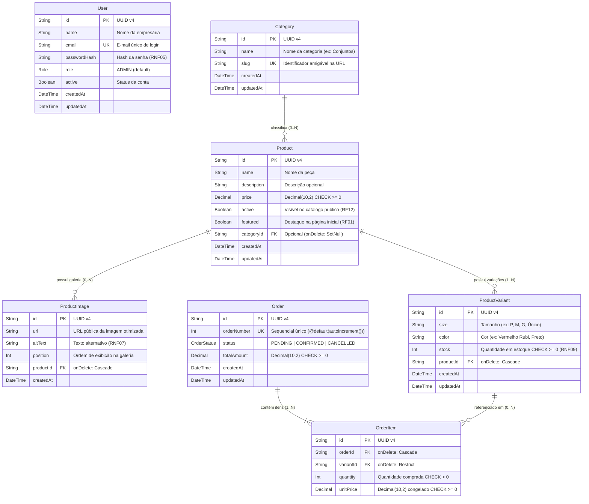

# Modelagem do Banco de Dados Relacional (MER) 🗄️

Este documento detalha o **Diagrama Entidade-Relacionamento (MER)**, o dicionário de dados, as políticas de integridade referencial (`onDelete`) e as restrições de defesa em profundidade (`CHECK constraints` e `UNIQUE`) do banco de dados **PostgreSQL** gerenciado via **Prisma ORM** ([`backend/prisma/schema.prisma`](file:///backend/prisma/schema.prisma)).

---

## 1. Diagrama Entidade-Relacionamento (Mermaid)

---

## 2. Rastreabilidade com Requisitos e Histórias de Usuário

| Entidade             | Requisitos Funcionais                                                                           | Requisitos Não Funcionais                             | User Stories                   |
| :------------------- | :---------------------------------------------------------------------------------------------- | :---------------------------------------------------- | :----------------------------- |
| **`User`**           | `RF11` (Autenticação do painel)                                                                 | `RNF05` (Hash de senha e segurança)                   | `US09`                         |
| **`Category`**       | `RF03` (Navegação por categorias)                                                               | —                                                     | `US02`                         |
| **`Product`**        | `RF01` (Destaques), `RF02` (Catálogo), `RF12` (Cadastrar, editar e ocultar)                     | —                                                     | `US01`, `US07`, `US09`, `US11` |
| **`ProductImage`**   | `RF04` (Galeria de fotos), `RF12`                                                               | `RNF02` (Imagens otimizadas), `RNF07` (`altText`)     | `US01`, `US09`                 |
| **`ProductVariant`** | `RF04` (Tamanhos e cores), `RF05` (Disponibilidade), `RF13` (Gestão de estoque)                 | `RNF09` (Integridade de estoque sem saldo negativo)   | `US03`, `US10`, `US12`         |
| **`Order`**          | `RF08` (Mensagem com número do pedido), `RF14` (Registro pendente), `RF15` (Confirmar/Cancelar) | `RNF06` (Privacidade: sem dados pessoais de clientes) | `US06`, `US08`, `US12`         |
| **`OrderItem`**      | `RF07` (Cálculo de total), `RF08`, `RF14`, `RF15`                                               | `RNF09` (Baixa consistente por variação)              | `US05`, `US06`, `US12`         |

---

## 3. Regras de Integridade Referencial e Constraints no PostgreSQL

### 3.1 Políticas de Deleção (`onDelete`)

- **`Category` $\rightarrow$ `Product` (`onDelete: SetNull`)**: Se uma categoria for removida, os produtos associados permanecem cadastrados com `categoryId = null`.
- **`Product` $\rightarrow$ `ProductImage` / `ProductVariant` (`onDelete: Cascade`)**: Ao excluir um produto que nunca teve pedidos, todas as suas fotos e variações são removidas automaticamente.
- **`Order` $\rightarrow$ `OrderItem` (`onDelete: Cascade`)**: Ao excluir um pedido, os itens daquele pedido são removidos juntos.
- **`ProductVariant` $\rightarrow$ `OrderItem` (`onDelete: Restrict`)**: Impede a exclusão física de uma variação de produto que já esteja referenciada em pedidos registrados, preservando a integridade histórica. Para retirar o produto da vitrine, utiliza-se `Product.active = false` (`RF12`).

### 3.2 Restrições de Unicidade (`UNIQUE`)

- `User.email`: impede contas administrativas duplicadas.
- `Category.slug`: garante URLs amigáveis únicas por categoria.
- `ProductVariant(productId, size, color)`: constraint composta `@@unique([productId, size, color])` que impede cadastrar duas vezes a mesma combinação de tamanho e cor para o mesmo produto.
- `Order.orderNumber`: número sequencial amigável único (ex.: `#1`, `#2`) exibido na mensagem do WhatsApp e no painel da empresária.

### 3.3 Defesa em Profundidade (`CHECK Constraints` Nativas no PostgreSQL)

Aplicadas na migration [`20261103211500_relational_schema/migration.sql`](file:///backend/prisma/migrations/20261103211500_relational_schema/migration.sql):

- **`Product_price_non_negative_chk`**: `CHECK ("price" >= 0)`
- **`ProductVariant_stock_non_negative_chk`**: `CHECK ("stock" >= 0)` — garante no nível do SGBD que mesmo atualizações simultâneas (`RNF09`) jamais resultem em estoque negativo.
- **`Order_totalAmount_non_negative_chk`**: `CHECK ("totalAmount" >= 0)`
- **`OrderItem_quantity_positive_chk`**: `CHECK ("quantity" > 0)`
- **`OrderItem_unitPrice_non_negative_chk`**: `CHECK ("unitPrice" >= 0)`
